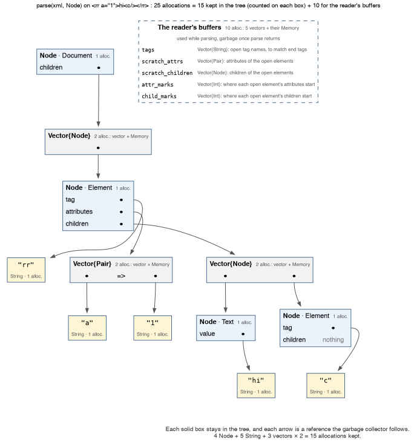
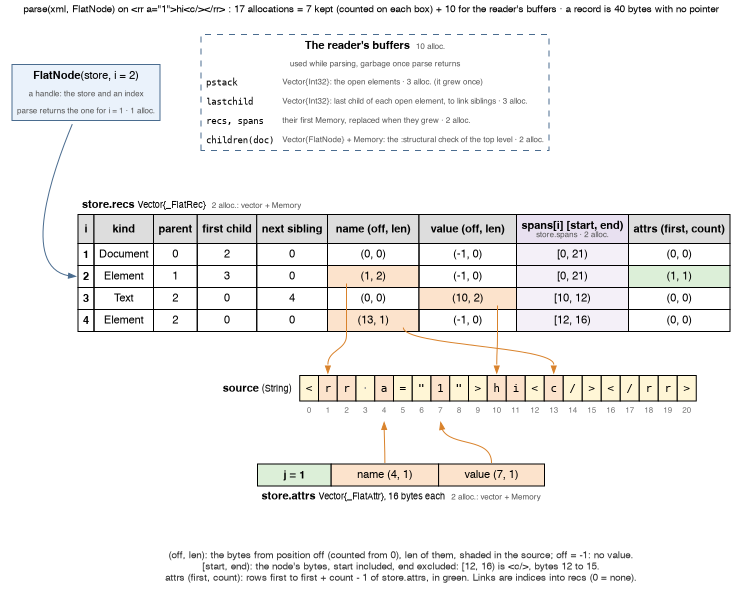
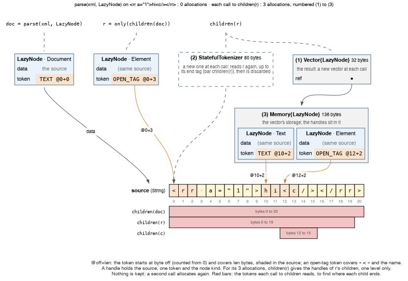

# How the readers store a document

`Node`, `FlatNode` and `LazyNode` can each read the same small document, `<rr a="1">hi<c/></rr>`. The diagrams below show what each one keeps in memory, and what it allocates along the way. A reader materializes the tree when it builds every node once and keeps it in memory. `Cursor` is left out: it keeps no structure and reads the document as a stream. The README [compares all four readers](README.md#choosing-a-reader) by what you do with a document.

The counts are those of Julia 1.13. Since Julia 1.11, a vector is two allocations, the array and its `Memory`, so Julia 1.10 gives other counts. [`assets/make_reader_diagrams.jl`](assets/make_reader_diagrams.jl) draws the diagrams, and first checks every count they show or this page quotes.

## `Node`: a tree of Julia objects

Each node, string and vector of the tree is a Julia object of its own. The garbage collector has to follow every reference between them for as long as the tree lives. The reader's buffers serve only while `parse` runs.

## `FlatNode`: one record per node in a few arrays

A record holds no pointer, only positions in the source and indices into `recs` and `attrs`. The garbage collector sees `recs`, `attrs`, `spans` and the source string, not one object per node. Parsing the 14 MB document of the README, 882 026 nodes, takes 40 allocations.

Here the source is the string passed to `parse`, with no copy. `parse` copies it only to normalize CR line ends, to apply what the internal subset declares, or to turn another string type into a `String`.

## `LazyNode`: nothing stored, handles made on access

To list the children of a node, `children` reads that node's whole content again, to find where each child ends: the red bars. Walking the tree through `children` thus reads a byte again at each level that contains it, so bytes 12 to 15 are read three times here. `Cursor` reads each byte once.

## Reading every node

Reading the kind, tag, attributes, value and children of every node allocates:

| | this example: parse + read | 14 MB document of the README: per node, parse + read |
|---|--:|--:|
| `Node` | 25 + 0 | 2.86 |
| `FlatNode` | 17 + 7 | 0.88 |
| `LazyNode` | 0 + 12, of which 8 in `children` and 4 in `attributes` | 1.59 |

`LazyNode` allocates less than `Node`, yet it is the slowest of the three to walk a whole document, because it reads the source again at each level. Walking every node of the 14 MB document takes 131 ms with `LazyNode`, against 29 ms with `FlatNode` and 71 ms with `Node`, parse included: see [Performance by access pattern](README.md#performance-by-access-pattern).
